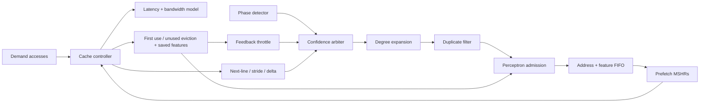

# Online perceptron extension — start here

This directory contains the original cache design plus an optional, online-trained
prefetch admission filter. `results/` contains the supplied historical results;
`results_ml/` contains the new simulations. Do not mix the two as a single run.

Read `results_ml/REPORT.md` for measured gains **and regressions**. This extension
is not a promise of improvement on every workload. `EN_PERCEPTRON=0` is the safe
default and preserves the original data-path behavior.

## Assessment of Claude's proposal

The proposal is technically sound as an experiment. A weighted dot product,
prediction-dependent decisions, and outcome-driven updates constitute a real
online ML component. The original phase detector, confidence counters and
throttle are adaptive heuristics, not a trained perceptron.

The concept is established prior art, not a new algorithm: Eshan Bhatia et al.,
*Perceptron-Based Prefetch Filtering*, ISCA 2019,
https://people.engr.tamu.edu/djimenez/pdfs/ppf_isca2019.pdf . This implementation
is inspired by that approach; it is not a reproduction of that paper's design
or experimental claims. A defensible contribution is integrating a small online
learner with this multi-engine prefetcher and measuring its tradeoffs.

There are four caveats to the suggested simple addition:

1. Aggregate useful/useless pulses cannot train the originating prediction.
   Save features with the request, through the queue, MSHR and resident line.
2. Rejected requests have no cache outcome. Periodic exploration is necessary
   to gather new evidence. It mitigates selection bias; it does not eliminate it.
3. Prefetch usefulness is not the same as latency saved. Late prefetches can be
   labeled useful while the CPU waits. Optimizing the label alone can lose speed.
4. Fewer transactions do not establish lower energy, and fewer simulated cycles
   do not establish higher FPGA throughput if the filter lowers achievable Fmax.

## Architecture understood from the source

The 16 KiB cache has 64 sets, four ways, 64-byte lines, write-back/write-allocate,
and selectable LRU/SRRIP/DRRIP replacement. Demand misses are blocking; a separate
16-entry prefetch MSHR file permits speculative memory transactions in flight.
Demand traffic wins memory arbitration. Prefetch installs avoid dirty victims.

Line transitions train next-line, region-indexed stride, and delta-correlation
predictors. A Boyer–Moore based phase classifier gates engines and confidence.
The arbiter favors corroborated stride predictions, otherwise selecting the
most confident eligible engine with a specificity tie break. The throttle
changes degree based on resolved useful/useless outcomes. A degree expander,
recent-line filter and FIFO feed the independent cache prefetch path.

The new block sits **after expansion and duplicate detection, before enqueue**.
Thus each lookahead line gets its own prediction and outcome. It filters the
arbiter's chosen stream; it does not re-arbitrate losing engine candidates.



## Exact learning rule

Each source uses a separate nine-weight vector: a bias plus eight bipolar inputs.
The four allocated banks use source IDs 0–3; bank 0 is unused. Weights are signed
6-bit values, saturating at -32 and +31. The score uses a signed integer sum, so
intermediate accumulation does not overflow. There are no multipliers: each
input selects addition or subtraction of a weight.

`score = bias + sum(weight[k] * x[k])`, where `x[k]` is +1 for feature bit 1 and
-1 for bit 0. Admit at score >= 0. Bias initializes to +8, other weights to 0.
The learner starts permissive, then learns from actual installed lines.

| Feature bits | Meaning at candidate generation |
|---|---|
| 0, 1 | Two bits of the captured hardware phase code |
| 2 | Expansion index >= 1 (second or later candidate) |
| 3 | Expansion index >= 2 |
| 4 | Expansion index >= 4 |
| 5 | Absolute byte step exceeds one cache line |
| 6 | Negative step |
| 7 | Candidate address bit 12 (coarse address context) |

The metadata is `{source[1:0], features[7:0]}`. It contains no software trace
label. Address context is inexpensive but layout-dependent; test address-remapped
traces before claiming generalization. Default intended address width is 32 bits
(this feature requires at least 13).

For outcome `y=+1` on first use, `y=-1` on unused eviction, recompute the score
from the saved features and current weights. If `y * score <= ML_MARGIN`, apply
`weight[k] = saturate(weight[k] + y*x[k])` and `bias = saturate(bias+y)`.
This margin update learns from mistakes and low-confidence correct predictions.
`ML_MARGIN=16` by default. Training uses the current score, not a stale score
stored when the prefetch was generated.

Useful and useless events can coincide. The combinational next-state calculation
applies useful first, then useless, preserving both updates even within one bank.
Demand fill and prefetch install are mutually exclusive in the existing array
write arbitration, so there is at most one unused eviction per cycle.

One in 32 negative-score candidates is admitted for exploration (first such
candidate included), controlled by `ML_EXPLORE_LOG2=5`, which must be >=1.
The timer advances only on eligible negative-score candidates. It is deterministic
and may alias with periodic streams; random exploration is a possible follow-up.
Queue-full cycles, duplicates, and dropped/uninstalled prefetches do not train.
There is no fabricated negative label from a timeout or trace ending.

## Run on Ubuntu / WSL2

Use Verilator 5.x, Python 3, a C++ compiler, make, and matplotlib. Prefer a Linux
home directory for direct builds; make-based builds do not reliably accept spaces
in their project path. The new study runner copies build inputs into a temporary
directory, so it also works when this package is under a Windows path with spaces.

```bash
sudo apt-get update
sudo apt-get install -y verilator build-essential python3-matplotlib
cd /path/to/micron_cache_ml
python3 scripts/gen_traces.py -o traces
python3 scripts/test_perceptron.py
python3 scripts/run_ml_study.py --jobs 4
python3 scripts/plot_ml.py
```

The unit test checks 5,400 cycles against an independent Python integer model,
including repeated negative/positive training, simultaneous feedback, saturation,
two reset sequences per run, exploration counters, and disabled bypass.

The study runs all seven full original traces, including the write-heavy trace,
for cache-only LRU, cache-only DRRIP, previous MMAP, and MMAP+perceptron.
Every read and every issued writeback is checked by the original testbench.
The runner requires zero mismatches, zero corrupt writeback words, the exact
trace access count, a PASS marker and successful process exit. Failures abort.

To also prove default-off equivalence, extract the supplied original ZIP into
a separate directory and pass its project root:

```bash
python3 scripts/run_ml_study.py --original /path/to/original/micron_cache
python3 scripts/plot_ml.py
```

This compares **every original integer STAT counter** with the disabled variant.
It is regression evidence on these traces, not a formal proof for all inputs.

The executable is rebuilt separately per configuration. No weights survive
between traces. Raw stdout/stderr and compiler logs are saved under `logs/`.
`manifest.json` records RTL/testbench hashes, trace hashes, simulator version,
parameters and expected access counts. `raw.json`/`raw.csv` are raw measurements;
`comparison.csv` and plots are derived only from them. Do not edit plot values.

### One trace / alternative parameters

```bash
python3 scripts/run_ml_study.py --workloads cnn --margin 16 --explore-log2 5 --out results_cnn
python3 scripts/plot_ml.py --results results_cnn

# Direct simulation, from a path without spaces:
bash sim/verilate.sh -o sim_ml -- -GEN_PERCEPTRON=1
./sim_ml +trace=traces/cnn.trace +tag=cnn_ml +stats=cnn.stats
bash sim/verilate.sh -o sim_old -- -GEN_PERCEPTRON=0
./sim_old +trace=traces/cnn.trace +tag=cnn_previous
```

Original ablation and geometry sweeps remain available:

```bash
chmod +x sim/verilate.sh
python3 scripts/run_sweep.py --jobs 4
python3 scripts/analyze.py
```

Those original sweeps use the default-off learner. For the new comparison use
`run_ml_study.py`; do not mistake the old `D1_full` label for ML-enabled.

### Questa / ModelSim

From the project root, run `vsim -c -do sim/modelsim.do`. Add
`-gEN_PERCEPTRON=1` to its `vsim` line for the learner; use 0 for previous.
Remove `+maxacc=20000` to run the complete trace and select the desired trace path.
The source list now includes `pf_perceptron.sv`, and root-relative paths are fixed.
This flow is supplied but has not been executed in this environment.

### Quartus area / timing

The synthesis wrapper exposes `EN_PERCEPTRON`, `ML_MARGIN`, and
`ML_EXPLORE_LOG2`; the QSF includes the new RTL source. Build with the learner
both disabled and enabled, preserving separate reports. Compare ALMs, registers,
RAM bits and achieved clock. The original `build.tcl` is inherited and should be
validated with your installed Quartus version; simulation does not validate it.

For parameterized project builds, use `set_parameter -name EN_PERCEPTRON 0`
or `1` before compilation (or the equivalent top-level parameter in the GUI).
The 100 MHz SDC is a target, not a measured achievement. No Quartus implementation
results are supplied by this extension.

Source-level storage estimate at default geometry: 216 weight bits (including
unused bank), 2,560 resident metadata bits, 160 FIFO bits, 160 MSHR bits,
10 probe bits, 20 feedback bits, 8 expander-context bits and 5 exploration bits:
about **3.14 kbits**, plus 192 observability-counter bits. Actual synthesis may
remove unused banks, constant fields and disabled logic. This is not an ALM or
RAM utilization report. Combinational inference and dual-event training can
affect timing; pipeline or serialize training if measured timing requires it.

## What changed

| File | Change |
|---|---|
| `rtl/pf_perceptron.sv` | New signed online learner, exploration and counters |
| `rtl/pf_engine.sv` | Candidate features, per-line admission, FIFO metadata |
| `rtl/cache_controller.sv` | Probe/MSHR/resident feature lifetime and labeled feedback |
| `rtl/ai_cache_top.sv` | Parameter and metadata wiring |
| `rtl/synth_top.sv` | Top-level learner parameters |
| `tb/tb_top.sv` | Parameter forwarding and ML statistics |
| `sim/verilate.sh`, `sim/modelsim.do`, QSF, Makefile | Build source lists / portability |
| `scripts/run_ml_study.py` | Reproducible fresh comparisons and disabled equivalence |
| `scripts/test_perceptron.py` | Independent arithmetic / control checks |
| `scripts/plot_ml.py` | CSV, report, plots; regressions retained |

The new block adds conditional admission without changing replacement policy,
memory latency, predictor tables or trace labels. It therefore measures the
incremental effect of learning, including interactions with the existing throttle.


