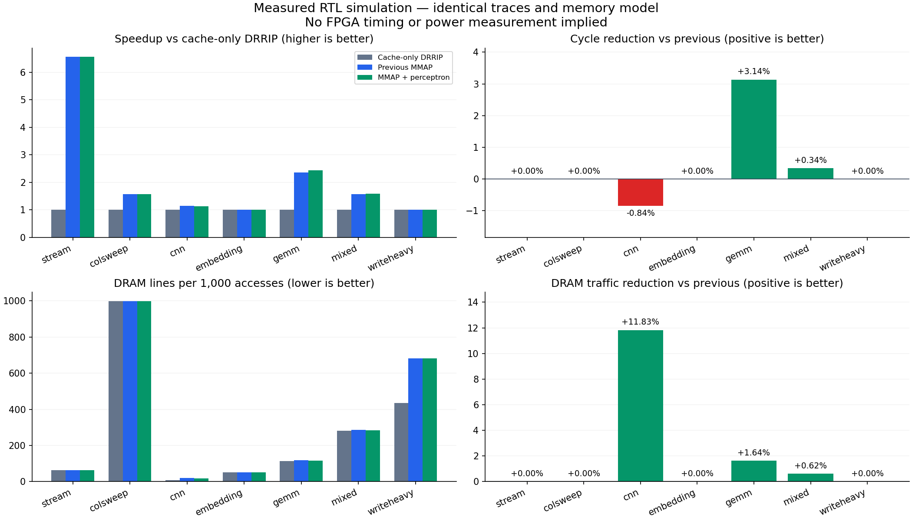
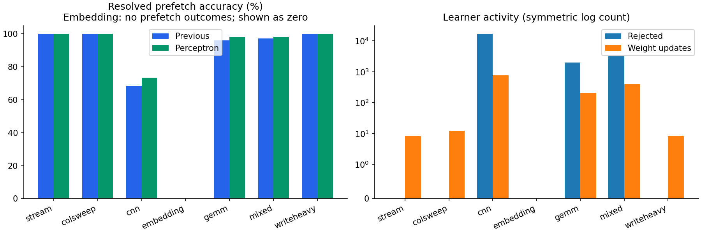

# Measured comparison

These are cycle-level RTL simulations on synthetic kernel traces. Negative reductions are regressions. Each design starts from reset; no weights are trained offline.

| Workload | Previous cycles | ML cycles | Speedup vs baseline | Cycle reduction vs previous | DRAM reduction vs previous |
|---|---:|---:|---:|---:|---:|
| stream | 117,226 | 117,226 | 6.551x | +0.000% | +0.000% |
| colsweep | 6,572,071 | 6,572,071 | 1.568x | +0.000% | +0.000% |
| cnn | 175,440 | 176,922 | 1.139x | -0.845% | +11.828% |
| embedding | 652,146 | 652,146 | 1.000x | +0.000% | +0.000% |
| gemm | 400,920 | 388,342 | 2.439x | +3.137% | +1.639% |
| mixed | 2,002,822 | 1,995,974 | 1.584x | +0.342% | +0.624% |
| writeheavy | 3,678,381 | 3,678,381 | 1.006x | +0.000% | +0.000% |

Geometric mean speedup: **1.7250x vs DRRIP baseline**, **1.0038x vs previous**.

All included runs passed the read-data and write-back checkers. The runner also verifies the expected trace access count. See raw.json, raw.csv, logs/, and manifest.json for evidence.

Accuracy = useful / (useful + useless). Unresolved resident prefetches and fills dropped before installation are excluded. Hit rate includes late prefetch merges, so cycles are the primary latency metric. DRAM traffic includes reads plus writebacks. No energy or achieved-clock claim follows from these counters.

